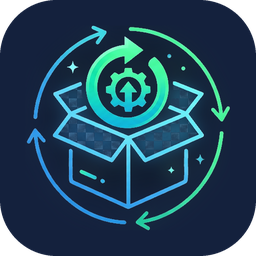

<p align="center">
  
</p>

<h1 align="center">Pacote Fresco</h1>

<p align="center">
  <b>Instaladores sempre fresquinhos.</b><br>
  Baixa as versões mais novas dos seus programas, confere hash e assinatura digital<br>
  e deixa tudo numa pasta pronta para copiar no pen drive.
</p>

<p align="center">
  
  
  
  
</p>

---

## Por que existe

Quem faz suporte de TI conhece a rotina: abrir o site de cada programa, baixar a versão mais nova, copiar para o pen drive e repetir para o próximo computador. O Pacote Fresco automatiza essa parte. Você cadastra uma vez o que quer manter atualizado, e o programa cuida de baixar, conferir e organizar.

## O que ele faz

- **Lista editável de programas**: cada linha tem nome, origem (winget ou link direto), ID ou URL e pasta de destino.
- **Duas origens de download**
  - `winget`: informe só o ID do pacote (ex.: `7zip.7zip`). O instalador é o oficial do fabricante.
  - `Link`: cole o endereço de download. Redirecionamentos são seguidos e o nome do arquivo é descoberto sozinho.
- **Só baixa o que mudou**: compara a versão (winget) ou ETag/tamanho (link). Existe a opção de forçar um novo download.
- **Confere a integridade**: calcula o **SHA256** e verifica a **assinatura digital** (Authenticode) de cada instalador. Se você informar um hash esperado, o arquivo divergente é recusado.
- **Troca segura de versão**: o instalador antigo só é apagado depois que o novo foi baixado e verificado, e só o arquivo que o próprio programa baixou.
- **Funciona com proxy corporativo**: usa o proxy do Windows com o seu login, ou um proxy informado manualmente.
- **Agendamento diário**: cria uma tarefa do Windows que roda em segundo plano, só com os programas marcados.
- **Log colorido** na tela e em arquivo, com hash e assinatura de cada instalador.

## Requisitos

| Item | Detalhe |
|---|---|
| Sistema | Windows 10 ou 11 |
| Runtime | .NET Framework 4.8 (já vem no Windows, nada a instalar) |
| winget | Necessário apenas para os itens com origem `winget` (vem no Windows 11 e em versões atualizadas do Windows 10) |

## Como compilar

1. Instale o **Visual Studio 2022 (Community)** com a carga de trabalho **Desenvolvimento para desktop com .NET**.
2. Abra o arquivo `PacoteFresco.csproj` como **projeto** (Arquivo > Abrir > Projeto/Solução).
3. Troque **Debug** por **Release** e use **Compilação > Compilar Solução**.
4. O executável fica em `bin\Release\net48\PacoteFresco.exe`.

Também funciona pela linha de comando, com o SDK do .NET instalado:

```powershell
dotnet build -c Release
```

Para distribuir, basta copiar o `PacoteFresco.exe`. Ele é um arquivo único e não exige instalação.

## Como usar

1. Abra o `PacoteFresco.exe`.
2. Em **Configurações**, escolha a **pasta padrão** dos instaladores e ajuste o proxy, se precisar.
3. Edite a lista: marque a coluna **Atualizar** nos programas desejados, ou use **+ Adicionar** para incluir outros.
4. Clique em **Atualizar marcados** e acompanhe o log.
5. Copie a pasta de destino para o pen drive.

### Rodando todo dia sozinho

Em **Configurações > Agendamento diário**, escolha o horário e clique em **Agendar**. O Windows passa a executar o programa em segundo plano (`PacoteFresco.exe /auto`), atualizando apenas os programas marcados.

> Mantenha o `.exe` em uma pasta fixa. Se ele for movido, a tarefa agendada deixa de encontrá-lo.

## Onde ficam os dados

A configuração e o log ficam em uma pasta oculta do seu usuário, e não ao lado do executável:

```
%LOCALAPPDATA%\PacoteFresco\
├── config.xml   lista de programas e opções
└── log.txt      histórico das execuções
```

O botão **Abrir pasta de dados**, em Configurações, leva direto até ela. Para levar sua lista para outro computador, copie o `config.xml` para o mesmo lugar.

## Perguntas frequentes

**O que significa `NotSigned` no log?**
O instalador não tem assinatura digital do fabricante. Isso não indica que o arquivo seja falso, só que a autoria não pôde ser comprovada por esse meio (alguns projetos, como o 7-Zip e o K-Lite, distribuem assim). Nos itens `winget`, o próprio winget valida o hash contra o manifesto oficial.

**O nome do arquivo termina em `en-US`. O instalador está em inglês?**
Não necessariamente. Esse sufixo é só um rótulo do winget para o idioma padrão do pacote, e o Pacote Fresco o remove do nome. O idioma real depende do instalador: o Acrobat Reader (MUI), o 7-Zip, o Chrome e o Teams são multilíngues e seguem o idioma do Windows. Programas como HandBrake, FastCopy, K-Lite e TightVNC só existem em inglês. Se o fabricante oferece um link direto em português, troque a origem do item para `Link` e cole esse endereço.

**Posso salvar tudo na mesma pasta?**
Sim, é o padrão. Em Configurações há a opção de criar uma subpasta por programa, e cada linha também aceita uma pasta de destino própria.

**Quais programas não dá para automatizar?**
Os que exigem login, aceite manual ou não têm um link fixo de "versão mais recente".

## Estrutura do projeto

```
PacoteFresco/
├── PacoteFresco.csproj   configuração do projeto, versão e direitos autorais
├── Program.cs            ponto de entrada e modo /auto
├── App.cs                nome, versão e pasta de dados
├── Models.cs             programas, configuração e lista inicial
├── Motor.cs              download, verificação de hash e assinatura, proxy
├── MainForm.cs           janela principal
├── ConfigForm.cs         configurações e agendamento
└── icone.ico             ícone do aplicativo
```

## Versionamento

O projeto segue o [Versionamento Semântico](https://semver.org/lang/pt-BR/): `MAIOR.MENOR.CORREÇÃO`. A versão aparece no cabeçalho do programa e em **Propriedades > Detalhes** do executável.

## Segurança

- Os downloads usam HTTPS (TLS 1.2).
- Nenhuma senha é guardada. O proxy usa as credenciais do Windows.
- Não inclua no repositório o `config.xml` nem o `log.txt`, pois podem conter caminhos e endereços internos da sua rede. O `.gitignore` já os ignora.

## Autor

Desenvolvido por **Pedro Weiss Paludeto**.

## Licença

Ainda não definida. Enquanto não houver um arquivo `LICENSE`, todos os direitos permanecem reservados ao autor.
